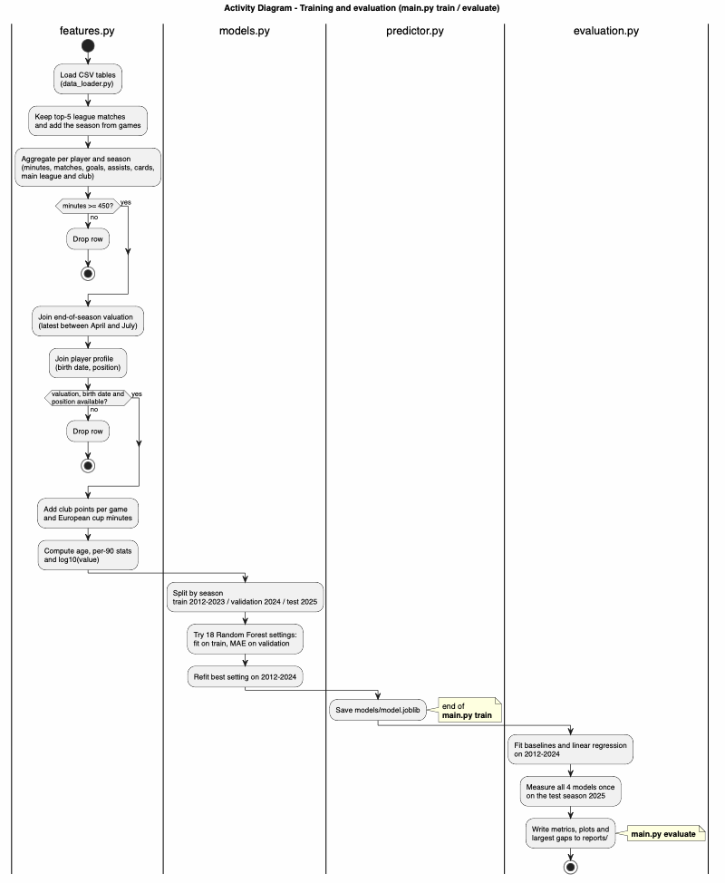
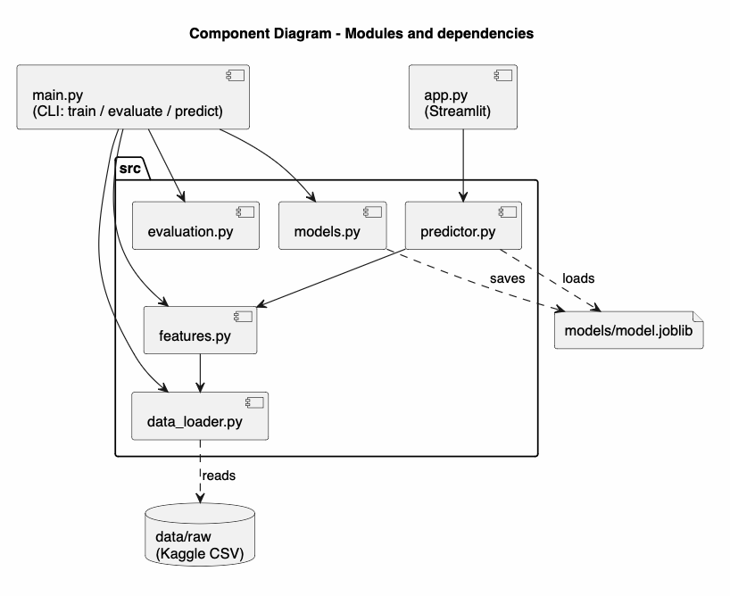
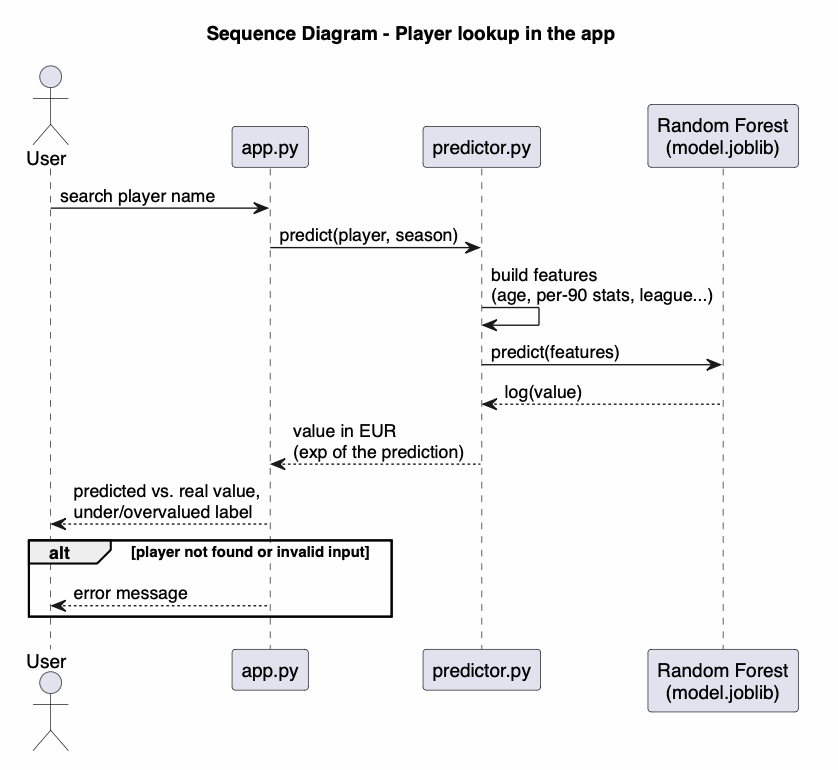
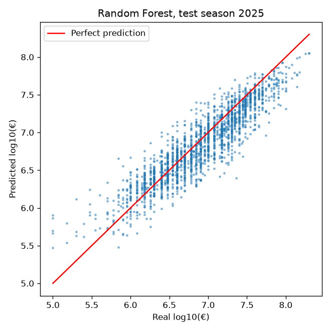

# Football Player Market Value Predictor

Estimate a football player's market value from their profile (age, position, league), the strength of their club and one season of performance, and explore the results in a simple web app.

> ITE semestral work, CTU Prague, autumn 2026.

## Purpose

Transfermarkt market values are hard to guess with a simple rule. This program:

1. Builds a player-season table from the public Transfermarkt dataset.
2. Trains and compares three levels of prediction methods:
   - **Baseline:** median value by position and league.
   - **Linear regression:** simple, interpretable benchmark.
   - **Random Forest:** main model, used by the app.
3. Shows predictions, real values and model insights in a Streamlit app.

**Target audience:** football fans, fantasy-league players and data-analytics students.

## Data

Kaggle dataset [Football Data from Transfermarkt](https://www.kaggle.com/datasets/davidcariboo/player-scores) (`davidcariboo/player-scores`).
License: CC0 (Public Domain). The data is **not** included in this repository.

- **Data coverage:** updates are paused; the dataset is current to 2026-07-06 (`player_valuations` ends on 2026-06-12, `appearances` on 2026-06-28). Last complete season: 2025/26.
- **Download date:** 2026-11-04

### Getting the data

**Option A — Kaggle API (used in this project).** The token is a secret: never commit it or share it.

1. Install the client (inside the virtual environment): `pip install kaggle`
2. On kaggle.com go to *Settings → API → Create New Token* and copy the token (it is shown only once).
3. Save it outside the repository with restricted permissions:
   ```bash
   mkdir -p ~/.kaggle
   pbpaste > ~/.kaggle/access_token   # macOS: pastes the clipboard; on Linux use: echo "<token>" > ...
   chmod 600 ~/.kaggle/access_token
   ```
   Alternative: set the `KAGGLE_API_TOKEN` environment variable.
4. Download and unzip into `data/raw/`:
   ```bash
   kaggle datasets download davidcariboo/player-scores -p data/raw --unzip
   ```

**Option B — manual.** Download the ZIP from the Kaggle page and run `unzip ~/Downloads/archive.zip -d data/raw`.

## Design

UML diagrams (PlantUML sources next to the images in [docs/diagrams/](docs/diagrams/)). Data decisions: [docs/data_quality.md](docs/data_quality.md); open problems and decisions: [docs/project_log.md](docs/project_log.md).





## Installation

Requirements: **Python 3.13** (tested with 3.13.7) and about 1 GB of disk for the data. Dependencies (exact versions in [requirements.txt](requirements.txt)): pandas, scikit-learn, matplotlib, joblib, streamlit, pytest and pytest-cov.

```bash
git clone https://github.com/hugohf05/semestral-work-ite.git
cd semestral-work-ite
python3 -m venv .venv
source .venv/bin/activate          # Windows: .venv\Scripts\activate
pip install -r requirements.txt
```

Then download the data into `data/raw/` (see [Getting the data](#getting-the-data)).

## Usage

All commands run from the repository root.

### 1. Train (about 1 minute)

```bash
python main.py train
```

Builds the player-season table, tries 18 Random Forest settings on the validation season (2024), refits the best one on seasons 2012–2024 and saves it to `models/model.joblib` (about 100 MB, not in Git).

### 2. Evaluate on the test season (2025)

```bash
python main.py evaluate
```

Compares the four models on the 2025/26 season, which was never used for training or tuning. Output in `reports/`:

| File | Content |
| --- | --- |
| `metrics_test.csv` | Metrics of the 4 models |
| `error_by_value_range.csv` | Error by value range (under-/overestimation) |
| `largest_gaps.csv` | Players with the largest predicted / real ratio |
| `predicted_vs_real.png`, `feature_importance.png`, `age_curve.png` | Plots |

### 3. Predict one player

```bash
python main.py predict "Pedri"                 # latest season of the player
python main.py predict "Pedri" --season 2022   # a given season (start year)
```

```text
Pedri (2025/2026)
  Real value:         150.0 M€
  Predicted value:     63.3 M€  (x0.42)
```

**Input:** a full or partial player name (case-insensitive; an exact name wins over partial matches) and optionally a season. **Output:** real value, predicted value and their ratio. Unknown or ambiguous names, missing data or a missing model give a one-line error and exit code 1. Predictions for 2012–2024 are optimistic because the model was trained on them; use 2025 for an honest prediction.

### 4. Web app

```bash
streamlit run app.py               # opens http://localhost:8501
```

| Page | Input | Output |
| --- | --- | --- |
| Player lookup | Name and season | Real vs. predicted value and the player's features |
| Manual estimate | Form: age, position, league, club points per game, minutes, goals… | Estimated value |
| Model insights | — | Test metrics and plots from `reports/` (run `evaluate` first) |
| Top undervalued | Maximum age, minimum value | Players of 2025 with the largest predicted / real ratio |

### Options

`--data-dir PATH` (default `data/raw`) and `--model PATH` (default `models/model.joblib`) go before the command, e.g. `python main.py --data-dir other/folder train`.

## Results (test season 2025/26, 1,964 players)

| Model | R² | Median error | Within ×2 |
| --- | --- | --- | --- |
| Global median | −0.15 | 72 % | 40 % |
| Median by position and league | 0.01 | 67 % | 44 % |
| Linear regression | 0.78 | 39 % | 77 % |
| **Random Forest** | **0.81** | **33 %** | **81 %** |

- Machine learning clearly beats the simple rules; the Random Forest beats the linear regression, but only by 0.03 in R².
- Most important features: age, club strength (points per game), league, minutes and minutes in European cups. Context matters more than goals.
- Validation (2024) gave almost the same result (R² 0.81), so the model was not tuned to one season.

Metrics, methods and hyperparameters are explained in [docs/project_description.md](docs/project_description.md#methods).



## Tests

```bash
python test_main.py
```

56 tests (unit and system), 87 % line coverage. Approach, rationale and sample input/output pairs: **[docs/tests.md](docs/tests.md)**.

## Limitations

- **Stars are underestimated** (players ≥ 50 M€ by about ×1.8 on average) and very cheap players overestimated: the model does not see skills, fame, injuries or contracts, and a Random Forest cannot predict above the values it has seen.
- **Only the top 5 leagues** (Premier League, LaLiga, Serie A, Bundesliga, Ligue 1) and only players with **at least 450 league minutes** in the season.
- **No contract feature:** the dataset only stores each player's current contract, which is wrong for past seasons.
- **Few statistics:** only goals, assists, cards and minutes; nothing defensive, so defenders and goalkeepers are described mostly by context.
- **Veterans (35+)** are overestimated; the "top undervalued" page therefore filters by age and value.
- **Frozen data:** the Kaggle dataset ends in July 2026; season 2013 has only about half the usual rows.
- Market value is Transfermarkt's estimate, **not** a transfer fee.

All problems found and decisions taken: [docs/project_log.md](docs/project_log.md).

## Use of generative AI

I used an AI assistant (Claude, in the code editor) throughout the project. It helped in three ways:

1. **Writing code faster.** It wrote much of the code that I would otherwise type by hand: pandas joins, scikit-learn pipelines, plots, the command line. This let me write more code, and better structured code, in the time available. I only kept code that I understand and could have written myself with more time; I asked for an explanation of every part and can explain each function.
2. **More tests in less time.** It helped me create and run many more tests (56) than I could have written by hand, so I could check the quality of both the code and the model continuously. Several real bugs were found this way (ambiguous player names, `None` becoming `NaN` in the hyperparameter search, an exact ×2 error not counted as within ×2).
3. **The visual app.** Front-end development is not my main interest. With the AI I could build a simple Streamlit app that explains the work in little time; the app has no logic of its own and only calls the tested functions in `src/`.

**What I decided and checked myself:** the project question and scope, the leagues, the valuation window, the 450-minute threshold, excluding the previous value (leakage), adding club strength instead of club names, using the test season only once, and the interpretation of every result. Every decision is recorded with its reason in [docs/project_log.md](docs/project_log.md), and the work was committed in small steps.

## Development plan (5 weeks, completed)

| Week | Goal | Done when |
| --- | --- | --- |
| 1 | Setup, design and data | Repo structure and data download; **UML diagrams** (`docs/diagrams/`) and **data quality report** ([docs/data_quality.md](docs/data_quality.md)) committed *before* the code; then `data_loader.py` + tests and a first EDA |
| 2 | Feature engineering | `features.py` builds the player-season table (top-5 leagues, joins, age, per-90 stats, filters) + tests, incl. no-leakage checks. *Changed in week 4:* club points per game and European minutes added instead of starts and clean sheets |
| 3 | Models and evaluation | Baselines, linear regression, tuned Random Forest, metrics and plots, `main.py` CLI + tests |
| 4 | Visual platform | `predictor.py` and Streamlit `app.py` (player lookup, manual estimate, model insights, top undervalued) + tests |
| 5 | Finish and present | `docs/tests.md`, coverage report, final README, release `v1.0.0`, slides incl. visual explanation of the three method levels |

## License

[MIT](LICENSE). The dataset has its own license; see the Kaggle page.
