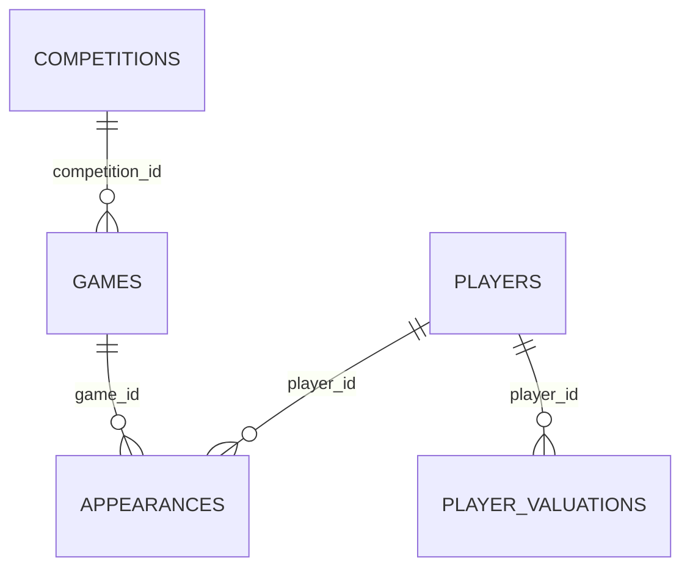

# Data quality report

Dataset: Kaggle *Football Data from Transfermarkt* (CC0), 12 CSV tables.
All numbers can be reproduced with `python -m src.data_quality` (requires the data in `data/raw/`, see README).

## 1. Overview of all tables

| Table | Rows | Cols | Used? | What it contains | Role in the project |
| --- | ---: | ---: | :---: | --- | --- |
| `players.csv` | 50,149 | 26 | **yes** | One row per player: birth date, position, foot, height, contract end, current market value | Player profile (features) |
| `appearances.csv` | 1,894,350 | 13 | **yes** | One row per player and match: minutes, goals, assists, cards | Performance features |
| `games.csv` | 88,958 | 23 | **yes** | One row per match: date, season, competition, competition type | Gives `appearances` a season and a competition type |
| `player_valuations.csv` | 656,301 | 6 | **yes** | Market value history (several rows per player) and the league at that date | **Target** and league feature |
| `competitions.csv` | 65 | 11 | **yes** | Competitions and their type (domestic league, cup…) | Select league competitions |
| `clubs.csv` | 796 | 17 | no | Clubs, squad size, average age | Not needed: the league comes from `appearances` |
| `club_games.csv` | 177,916 | 11 | **planned** | Match result per club (goals for/against, win) | Team goals conceded, clean sheets, wins (see [feature_sources.md](feature_sources.md)) |
| `game_events.csv` | 1,274,469 | 11 | no | Goals, cards, substitutions per match | Not needed (goals/assists are already in `appearances`) |
| `game_lineups.csv` | 3,179,016 | 10 | **planned** | Starting lineups and substitutes, position played, captain | Starts, captain (see [feature_sources.md](feature_sources.md)) |
| `transfers.csv` | 175,165 | 10 | no | Transfers and fees | Not needed (fees would leak the target) |
| `countries.csv` | 124 | 8 | no | Countries | Not needed |
| `national_teams.csv` | 124 | 17 | no | National teams | Not needed |

Common to every table: **0 fully duplicated rows**. Only the 5 used tables are loaded by `src/data_loader.py`; the 2 planned ones are added in week 2.

## 2. How the used tables are joined

`appearances` + `games` (season, competition type) → aggregate per player and season → join `players` (profile) and the end-of-season row of `player_valuations` (target and league).

## 3. Quality findings of the used tables

| Table | Finding | Impact | Action |
| --- | --- | --- | --- |
| `players` | `market_value_in_eur` and `highest_market_value_in_eur` are present | Data leakage (the highest value can be a *future* value) | Never loaded; tested in `test_data_loader.py` |
| `players` | `contract_expiration_date` is missing for 37 % of players and only describes the *current* contract | Invalid for old seasons | **Decided: feature dropped** |
| `players` | `foot` missing for 11.8 %; 586 players have position `Missing`; 13 heights below 140 cm | Noise in minor features | Impute or drop; treat `Missing` as its own category or drop |
| `players` | 20,619 of 50,149 players (41 %) have no appearance | They cannot form a player-season row | Dropped naturally by the join |
| `players` | `date_of_birth` is stored as `1978-06-09 00:00:00`; text fields have trailing spaces | Parsing errors | Parsed and stripped in the loader; tested |
| `appearances` | **Only covers 2012-07-03 → 2026-06-28** (seasons 2012–2025, 14 seasons), while valuations start in 2000 | Earlier valuations are unusable | Player-seasons start in 2012 |
| `appearances` | No missing values; 2 `player_id`s are not in `players` | Negligible | Dropped by the join |
| `appearances` | `minutes_played` up to 148 (3 rows above 120) and 3 rows with 0 minutes | Possible extra time / errors | Keep; the 450-minute filter removes players with tiny totals |
| `appearances` | Includes national-team matches (3,027 rows), cups and qualifiers; 14,200 rows whose match has no `competition_type` | Mixes club and national-team minutes | Keep only club competitions; decide for the 14,200 unknown rows in week 2 |
| `games` | `season` is the **start year** (2025 = 2025/26); `competition_type` missing in 1.4 % | Easy to misread seasons | Document and test the season mapping |
| `player_valuations` | `player_club_domestic_competition_id` missing in 14.2 % of rows | No league for those valuations | **Decided:** the league is taken from `appearances` instead |
| `player_valuations` | 1 valuation equals 0 € | `log(0)` is undefined | Drop values ≤ 0 before the log transform |
| `player_valuations` | Valuations in May–June per year: 2,328 (2014) and 2,701 (2020) vs. 12,000–22,000 from 2017 on | End-of-season target is sparse in those years | **Decided:** last valuation between 1 April and 31 July, rows without one are dropped (coverage: 12 % → 99 % for 2019/20 compared with May–July) |
| `player_valuations` | Data ends on 2026-06-12 | Season 2025/26 only has valuations up to mid June | Last complete season for testing is 2025 |
| `competitions` | 31 domestic leagues (not only the main European ones) | "Main European leagues" must be defined | **Decided:** top 5 only (`ES1`, `GB1`, `IT1`, `L1`, `FR1`): about 1,950 player-seasons with ≥ 450 minutes per season |

## 4. Decisions

| Topic | Decision |
| --- | --- |
| Leagues | Top 5: `ES1`, `GB1`, `IT1`, `L1`, `FR1` |
| Target | Last valuation between 1 April and 31 July of the year the season ends; rows without one are dropped |
| League feature | League with most minutes of the player in `appearances` |
| Contract | Dropped (only the current contract is known) |
| Minimum minutes | 450 per season (configurable; compared with 200 and 900 in the EDA) |
| Goalkeepers | Kept; one model with position as a feature, error reported per position |
| Extra statistics | See [feature_sources.md](feature_sources.md) |

Everything found along the way is recorded in [project_log.md](project_log.md).
